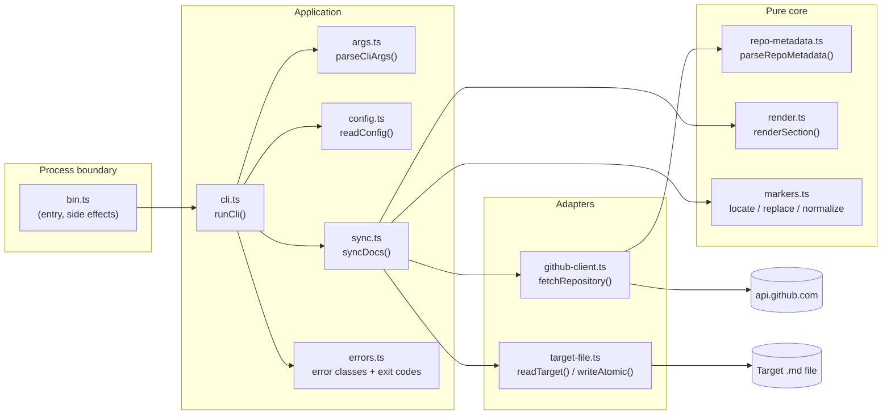
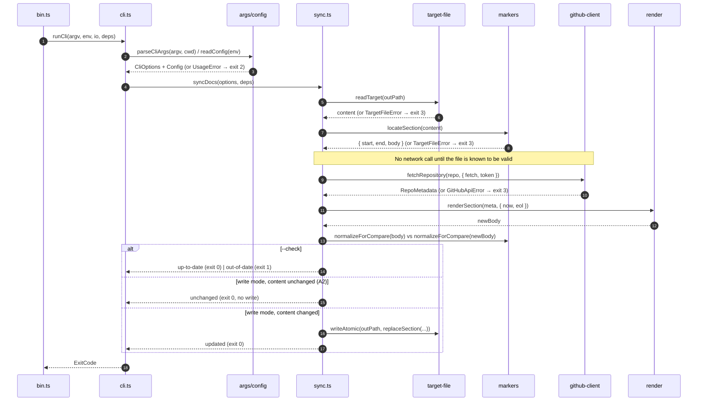

# Architecture: Automated Documentation Sync (`doc-sync`)

> SDLC Step 2 · Input: [requirements.md](requirements.md) (approved) · Status: **Approved (2026-10-13)**

## 1. Context and Goals

`doc-sync` is a small, dependency-free CLI inside this boilerplate. It turns one GitHub REST call into a Markdown table and places it between markers in an existing file. The design follows three goals:

1. **Pure core, I/O at the edges.** Argument validation, response parsing, rendering and marker handling are pure functions, so most requirements can be tested without a network or a file system (NFR-4.1).
2. **One process boundary.** Only the CLI entry point touches `process.env`, stdout/stderr and the exit code (NFR-3.3).
3. **Fail before side effects.** Inputs and the target file are validated before the network call, and nothing is written until the new content is fully computed (FR-7, FR-11, NFR-2.1).

## 2. Components



All modules live in `src/doc-sync/`.

| Module              | Responsibility                                                                                                                                                                                                              | Requirements                | Side effects                                                    |
| ------------------- | --------------------------------------------------------------------------------------------------------------------------------------------------------------------------------------------------------------------------- | --------------------------- | --------------------------------------------------------------- |
| `bin.ts`            | The only module with top-level code. Calls `runCli(process.argv.slice(2), process.env, …)` and sets `process.exitCode`. It is intentionally tiny and excluded from coverage                                                  | NFR-3.3                     | **Yes, intentional**: reads argv/env, sets the exit code          |
| `cli.ts`            | Composition root. Wires in the real dependencies, calls `syncDocs`, turns the `SyncResult` or an error into stdout/stderr lines and an `ExitCode`, and prints usage                                                          | FR-1, FR-9, FR-10, NFR-2.3  | Writes only to the injected `stdout`/`stderr` streams           |
| `args.ts`           | Wraps `util.parseArgs` (`strict: true`), validates `--repo` (FR-2), and lexically resolves `--out` against the cwd, rejecting absolute or escaping paths                                                                      | FR-1, FR-2, NFR-1.4         | None (pure; `cwd` is passed in)                                  |
| `config.ts`         | Central env validation: `readConfig(env)` returns `{ token?: string }`. Trims the value and treats an empty one as absent; rejects a token containing whitespace or control characters (header-injection guard)              | FR-3, NFR-1.1, NFR-3.3      | None (env object is passed in)                                   |
| `github-client.ts`  | `fetchRepository(ref, deps)` builds the URL from the fixed base `https://api.github.com` with `encodeURIComponent` segments, sets the headers and `AbortSignal.timeout(10_000)`, maps status codes to `GitHubApiError`, and passes the JSON to `parseRepoMetadata` | FR-3, FR-11, NFR-1.1, NFR-1.5, NFR-2.2 | Network, through the injected `fetch` |
| `repo-metadata.ts`  | `parseRepoMetadata(json: unknown)` narrows the body with type guards into `RepoMetadata` and maps "missing" values (`null`, `""`, whitespace, `[]`) to `null`. A body that is not an object, or that lacks `full_name`/`html_url`, is reported as malformed | FR-4, FR-5, FR-6, FR-11 | None (pure) |
| `render.ts`         | `renderSection(meta, { now, eol })` produces the timestamp line plus the table in a fixed row order. It sanitizes every cell (`\|` escape, newline collapse, `<!--`/`-->` neutralization), allows only `http(s)` links, and renders missing values as `Not Found` | FR-4, FR-5, FR-8, NFR-1.2, NFR-1.3, NFR-2.4 | None (pure; the clock is passed in) |
| `markers.ts`        | `locateSection(content)` finds exactly one start-marker line followed by exactly one end-marker line, or throws a `TargetFileError`. `replaceSection` splices in a new body. `normalizeForCompare` drops the `_Last synced:_` line and normalizes EOLs. `detectEol` returns CRLF or LF | FR-7, FR-10, A2 | None (pure) |
| `target-file.ts`    | `readTarget(path, fs)` uses `realpath` to confirm the file is inside the cwd (catches symlink escapes), checks it is a regular file, and reads it as UTF-8. `writeAtomic(path, content, fs)` writes a temporary file in the same directory, renames it over the target, and removes the temporary file if anything fails | FR-7, NFR-1.4, NFR-2.1 | File system, through the injected `fs` |
| `sync.ts`           | `syncDocs(options, deps)` orchestrates the run: read, locate, fetch, render, compare, then write or skip. Returns a `SyncResult`                                                                                              | FR-6–FR-10, A2              | Only through the injected adapters                              |
| `errors.ts`         | `DocSyncError` (abstract) and its subclasses `UsageError`, `GitHubApiError`, `TargetFileError`, each with a typed `reason` and an optional `cause`; `exitCodeFor(error)`                                                     | FR-11, NFR-2.3, NFR-3.3     | None                                                            |

## 3. Data Flow



### Marked section format

Markers are only recognized when they sit on their own line; surrounding whitespace is allowed. Everything between the two marker lines belongs to the tool:

```markdown
<!-- doc-sync:start -->
_Last synced: 2026-10-13T09:30:00Z_

| Field          | Value                                       |
| -------------- | ------------------------------------------- |
| Name           | node-typescript-boilerplate                 |
| Full Name      | jsynowiec/node-typescript-boilerplate       |
| Description    | Minimalistic project template to jump …     |
| URL            | [github.com/jsynowiec/…](https://github.com/jsynowiec/node-typescript-boilerplate) |
| Default Branch | `main`                                      |
| License        | Apache License 2.0 (Apache-2.0)             |
| Topics         | `boilerplate`, `nodejs`, `typescript`       |
| Homepage       | Not Found                                   |
| Created        | 2017-03-02                                  |
<!-- doc-sync:end -->
```

The table is not column-padded. Each row is `| Field | Value |`, which keeps the output deterministic and keeps diffs small (NFR-2.4).

## 4. Key Types (sketch)

```ts
export interface RepoRef {
  readonly owner: string;
  readonly name: string;
}

export interface CliOptions {
  readonly repo: RepoRef;
  readonly outPath: string; // absolute, lexically inside cwd
  readonly check: boolean;
}

export interface RepoMetadata {
  readonly name: string;
  readonly fullName: string;
  readonly htmlUrl: string;
  readonly description: string | null;
  readonly defaultBranch: string | null;
  readonly license: { readonly name: string; readonly spdxId: string | null } | null;
  readonly topics: ReadonlyArray<string>; // empty → "Not Found"
  readonly homepage: string | null;
  readonly createdAt: string | null; // ISO string from API
}

export type SyncResult =
  | { readonly kind: 'updated' }
  | { readonly kind: 'unchanged' }
  | { readonly kind: 'up-to-date' }
  | { readonly kind: 'out-of-date' };

export type GitHubApiErrorReason =
  | 'not-found' | 'unauthorized' | 'rate-limited' | 'forbidden'
  | 'server-error' | 'network' | 'timeout' | 'malformed-response';

export type TargetFileErrorReason =
  | 'not-found' | 'not-a-file' | 'outside-cwd' | 'read-failed'
  | 'missing-start-marker' | 'missing-end-marker' | 'markers-out-of-order'
  | 'duplicate-markers' | 'write-failed';

// Narrow injectable seams (NFR-4.1)
export type FetchLike = (input: string, init: RequestInit) => Promise<Response>;
export interface FileSystemLike {
  readFile(path: string, enc: 'utf8'): Promise<string>;
  writeFile(path: string, data: string, enc: 'utf8'): Promise<void>;
  rename(from: string, to: string): Promise<void>;
  rm(path: string, opts: { force: true }): Promise<void>;
  realpath(path: string): Promise<string>;
  stat(path: string): Promise<{ isFile(): boolean }>;
}
export interface SyncDeps {
  readonly fetch: FetchLike;
  readonly fs: FileSystemLike;
  readonly now: () => Date;
  readonly token: string | undefined;
  readonly cwd: string;
}
```

`switch` statements over `SyncResult['kind']` and over each `reason` union use `never` checks, so adding a case is a compile error until every switch handles it.

## 5. Error Model and Exit Codes

| Error                                                       | Raised by                              | Exit                    |
| ----------------------------------------------------------- | -------------------------------------- | ----------------------- |
| `UsageError` (bad/missing/unknown flags, invalid repo, `--out` outside cwd, bad token format) | `args.ts`, `config.ts` | `2` |
| `TargetFileError` (any reason)                              | `target-file.ts`, `markers.ts`         | `3`                     |
| `GitHubApiError` (any reason)                               | `github-client.ts`, `repo-metadata.ts` | `3`                     |
| Anything else (bug)                                         | –                                      | `3`, with a generic message |
| `SyncResult` `out-of-date`                                  | `sync.ts`                              | `1`                     |
| `updated` / `unchanged` / `up-to-date` / `--help`           | –                                      | `0`                     |

**Secret safety (NFR-1.1).** Error messages are built from fixed templates plus the status code, the repo ref and reset times. Response bodies and request headers are never included. `cli.ts` prints only `error.message`, never `cause` or stacks. As defense in depth, it also redacts any occurrence of the token from its output before writing.

**Rate limit detection.** A response counts as rate-limited when the status is `429`, or the status is `403` and either `x-ratelimit-remaining: 0` or a `retry-after` header is present. If `x-ratelimit-reset` exists, it is shown as an ISO time.

## 6. Technology Choices

| Concern         | Choice                                    | Alternatives considered                    | Why                                                                                     |
| --------------- | ----------------------------------------- | ------------------------------------------ | --------------------------------------------------------------------------------------- |
| HTTP            | Global `fetch` (Node 24) + `AbortSignal.timeout` | `@octokit/rest`, `undici`, `axios`  | One endpoint does not justify a dependency (NFR-3.1); `fetch` is easy to inject          |
| Arg parsing     | `node:util` `parseArgs` (`strict: true`)  | `commander`, `yargs`                       | Built in; strict mode already rejects unknown flags (FR-1)                               |
| File I/O        | `node:fs/promises` + temp-file `rename`   | `write-file-atomic`                        | Same atomicity guarantee without a dependency                                           |
| Rendering       | String building in `render.ts`            | Handlebars or other template engines       | 9 fixed rows; a template engine adds a dependency and an injection surface              |
| Clock           | Injected `now: () => Date`                | `vi.setSystemTime` only                    | Deterministic tests without global fake timers                                          |
| Validation      | Hand-written type guards                  | `zod`                                      | The schema is small; no dependency needed                                               |

## 7. Testing Strategy

| Level       | Location                                     | What                                                                                                                                                       | Fakes                                                       |
| ----------- | -------------------------------------------- | ---------------------------------------------------------------------------------------------------------------------------------------------------------- | ----------------------------------------------------------- |
| Unit        | `__tests__/unit/doc-sync/<module>.test.ts`   | One file per pure module: args, config, repo-metadata, render, markers, errors; github-client with a fake `fetch`; sync with a fake `fs` and `fetch`       | `fetch` returns `new Response(...)`; in-memory `fs` object  |
| Integration | `__tests__/integration/doc-sync.test.ts`     | `runCli` end to end with the **real** file system in an `fs.mkdtemp` directory and a fake `fetch`. Asserts exit codes, stdout/stderr, file bytes (including CRLF), that a failure leaves the file untouched, and that the token never appears in any output | Only `fetch` and `now`                                      |
| Manual smoke (Step 7) | –                                  | A real run against a public repo, for the content-quality check of the generated document                                                                  | None                                                        |

No test makes a real network call. The integration tests clean up their temp directories in `afterEach`.

## 8. File Layout and Build/CI Changes

```text
src/doc-sync/
  bin.ts  cli.ts  args.ts  config.ts  errors.ts
  github-client.ts  repo-metadata.ts
  render.ts  markers.ts  target-file.ts  sync.ts
__tests__/unit/doc-sync/*.test.ts
__tests__/integration/doc-sync.test.ts
```

Proposed changes:

1. **`package.json` scripts**
   - `"doc-sync": "node build/doc-sync/bin.js"`. The current `tsconfig.json` has `rootDir: src` and `outDir: build`, so `src/doc-sync/bin.ts` compiles to `build/doc-sync/bin.js`.
   - `"test:integration": "vitest run integration --config __tests__/vitest.config.ts"`. The existing `test` script filters on `unit`, so integration tests would not otherwise run.
2. **`.github/workflows/nodejs.yml`**: add `npm run test:integration` to the `tests` job.
3. **`__tests__/vitest.config.ts`**: exclude `src/doc-sync/bin.ts` from coverage.
4. **`README.md`**: add a short "doc-sync" usage section.
5. No changes to `tsconfig*.json`, ESLint or Prettier config. No new dependencies.

> Observation, out of scope: the existing `"start": "node build/src/main.js"` does not match `rootDir: src` (which outputs `build/main.js`). It is not touched; this is noted for the design review.

## 9. Requirement Traceability

| Requirement | Component(s)                                     |
| ----------- | ------------------------------------------------ |
| FR-1        | `args.ts`, `cli.ts`                              |
| FR-2        | `args.ts`                                        |
| FR-3        | `github-client.ts`, `config.ts`                  |
| FR-4        | `repo-metadata.ts`, `render.ts`                  |
| FR-5        | `repo-metadata.ts`, `render.ts`                  |
| FR-6        | `repo-metadata.ts`, `sync.ts`                    |
| FR-7        | `markers.ts`, `target-file.ts`                   |
| FR-8        | `render.ts`                                      |
| FR-9        | `sync.ts`, `cli.ts`                              |
| FR-10       | `sync.ts`, `markers.ts`, `cli.ts`                |
| FR-11       | `github-client.ts`, `errors.ts`, `cli.ts`        |
| NFR-1       | `config.ts`, `render.ts`, `args.ts`, `target-file.ts`, `github-client.ts`, `cli.ts` |
| NFR-2       | `target-file.ts`, `github-client.ts`, `errors.ts`, `render.ts` |
| NFR-3       | all; `bin.ts` is the only side-effect module     |
| NFR-4       | `SyncDeps` seams; test strategy (§7)             |

## 10. Risks and Open Questions (for Step 3 design review)

| #   | Item                                                                                                                                       | Initial view                                                                       |
| --- | ------------------------------------------------------------------------------------------------------------------------------------------ | ---------------------------------------------------------------------------------- |
| R1  | Unauthenticated rate limit (60 req/h) on shared CI runners                                                                                 | Clear `rate-limited` message suggesting `GITHUB_TOKEN`                              |
| R2  | GitHub response shape changes                                                                                                              | Type guards; only `full_name`/`html_url` are required, everything else degrades to `Not Found` |
| R3  | Race between reading and writing (the file is edited while the tool runs)                                                                  | Accept; the run is short and the write is atomic                                    |
| R4  | `rename` over an open file on Windows can fail with `EPERM`                                                                                | Surface it as `write-failed`; no retry (retries are out of scope)                   |
| R5  | A symlinked `--out` that points outside the cwd                                                                                            | `realpath` check in `readTarget`                                                    |
| R6  | Does `--repo` matching need to be case-insensitive, or follow GitHub redirects for renamed repos?                                           | `fetch` follows redirects by default; the rendered `full_name` comes from the API   |
| R7  | Sample target for the Step 7 content check: add markers to `README.md` or to a new `docs/PROJECT_INFO.md`?                                  | Open                                                                               |
