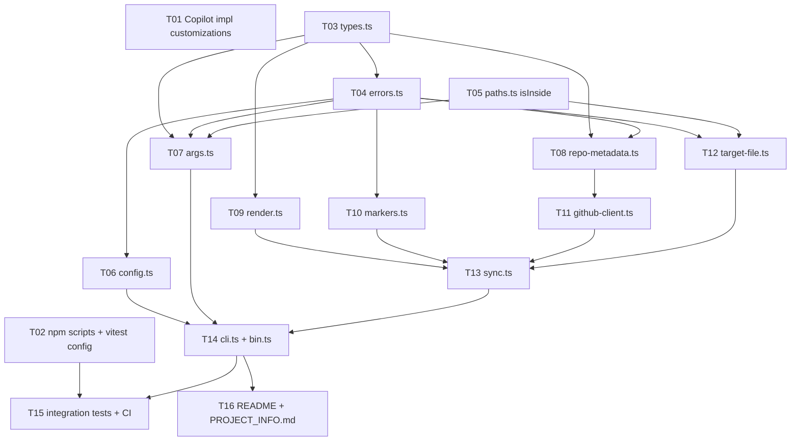

# Implementation Plan: Automated Documentation Sync (`doc-sync`)

> SDLC Step 4 · Inputs: [architecture.md](architecture.md) (rev. §11), [design-review.md](design-review.md) (agreed) · Status: **Approved (2026-10-13)**

## 1. Summary

The work is **16 tasks in 6 waves**. Wave 0 sets up the Copilot customizations for Step 5, the npm and Vitest wiring, and the shared foundations. Modules are then built from the leaves upward (pure core → adapters → orchestrator → CLI), so each task can be tested against tasks that are already finished. Integration tests, docs and the sample target come last.

### Definition of Done (every task)

- Code follows `AGENTS.md`: strict TypeScript, no `any`, no `!`, named exports, `readonly` shapes, exhaustive `never` checks, errors keep their `cause`, no logging outside `cli.ts`/`bin.ts`.
- The task's tests are written and pass. Each acceptance criterion below has at least one test.
- `npm run lint`, `npm run prettier:check`, `npm run check-types` and `npm test` are all green.
- No new dependencies, and no changes to files outside the task's list.

## 2. Dependency Graph

## 3. Waves

| Wave | Tasks                         | Parallel? | Gate to next wave                                     |
| ---- | ----------------------------- | --------- | ----------------------------------------------------- |
| 0    | T01, T02, T03, T05            | Yes       | Customizations in place; `npm test` still green       |
| 1    | T04                           | –         | Error classes and `exitCodeFor` tested                |
| 2    | T06, T07, T08, T09, T10, T12  | Yes       | All pure modules and the file adapter are tested      |
| 3    | T11                           | –         | GitHub client tested against a fake `fetch`           |
| 4    | T13 → T14                     | No        | `runCli` unit tested; build produces `build/doc-sync/bin.js` |
| 5    | T15, T16                      | Yes       | Full verification (Step 7)                            |

## 4. Task Table

| ID  | Title                               | Files                                                                                         | Refs                                               | Depends on            | Size |
| --- | ----------------------------------- | --------------------------------------------------------------------------------------------- | -------------------------------------------------- | --------------------- | ---- |
| T01 | Copilot implementation customizations | `.github/agents/implementer.agent.md`, `.github/prompts/5-implement.prompt.md`, `.github/instructions/doc-sync.instructions.md`, `.github/skills/verify-doc-sync/SKILL.md`, `.github/hooks/doc-sync.json` | Brief Step 5 | – | S |
| T02 | npm scripts + Vitest config         | `package.json`, `__tests__/vitest.config.ts`                                                  | Arch §8.1, §8.3; DR-9                              | –                     | S    |
| T03 | Shared types                        | `src/doc-sync/types.ts`                                                                       | Arch §4                                            | –                     | S    |
| T04 | Error model                         | `src/doc-sync/errors.ts`, `__tests__/unit/doc-sync/errors.test.ts`                            | FR-11, NFR-2.3, NFR-3.3; DR-3                      | T03                   | S    |
| T05 | Path containment helper             | `src/doc-sync/paths.ts`, `__tests__/unit/doc-sync/paths.test.ts`                              | NFR-1.4; DR-5                                      | –                     | S    |
| T06 | Config (env)                        | `src/doc-sync/config.ts`, `…/config.test.ts`                                                  | FR-3, NFR-1.1, NFR-3.3; DR-10                      | T04                   | S    |
| T07 | CLI argument parsing                | `src/doc-sync/args.ts`, `…/args.test.ts`                                                      | FR-1, FR-2, NFR-1.4; DR-5                          | T03, T04, T05         | M    |
| T08 | Response parsing                    | `src/doc-sync/repo-metadata.ts`, `…/repo-metadata.test.ts`                                    | FR-4, FR-5, FR-6, FR-11; DR-8                      | T03, T04              | M    |
| T09 | Rendering + escaping                | `src/doc-sync/render.ts`, `…/render.test.ts`                                                  | FR-4, FR-5, FR-8, NFR-1.2, NFR-1.3, NFR-2.4; DR-1, DR-7 | T03              | M    |
| T10 | Marker handling                     | `src/doc-sync/markers.ts`, `…/markers.test.ts`                                                | FR-7, FR-10, A2; DR-4, DR-11                       | T04                   | M    |
| T11 | GitHub client                       | `src/doc-sync/github-client.ts`, `…/github-client.test.ts`                                    | FR-3, FR-11, NFR-1.1, NFR-1.5, NFR-2.2; DR-2, DR-3 | T08 (+T03, T04)       | M    |
| T12 | Target file adapter                 | `src/doc-sync/target-file.ts`, `…/target-file.test.ts`                                        | FR-7, NFR-1.4, NFR-2.1; DR-5, DR-6                 | T04, T05              | M    |
| T13 | Sync orchestrator                   | `src/doc-sync/sync.ts`, `…/sync.test.ts`                                                      | FR-6–FR-10, A2                                     | T09, T10, T11, T12    | M    |
| T14 | CLI composition + entry             | `src/doc-sync/cli.ts`, `src/doc-sync/bin.ts`, `…/cli.test.ts`                                 | FR-1, FR-9, FR-10, NFR-1.1, NFR-2.3; DR-12, DR-13  | T06, T07, T13         | M    |
| T15 | Integration tests + CI              | `__tests__/integration/doc-sync.test.ts`, `.github/workflows/nodejs.yml`                      | NFR-4.2; DR-10, DR-11; Arch §7, §8.2               | T02, T14              | M    |
| T16 | Docs + sample target                | `README.md`, `docs/PROJECT_INFO.md`                                                           | Arch §8.4, §8.5; R7; DR-4                          | T14                   | S    |

`…/` is short for `__tests__/unit/doc-sync/`.

## 5. Task Detail and Acceptance Criteria

**T01 – Copilot implementation customizations**
- The `implementer` agent implements exactly one task from this plan at a time. It writes the tests first or alongside the code, runs the verify skill, and stops for human approval.
- `doc-sync.instructions.md` (`applyTo: src/doc-sync/**,__tests__/**/doc-sync/**`) encodes the module rules: no `process` access outside `bin.ts`/`cli.ts`, all I/O injected, and a fixed message template for errors.
- The `verify-doc-sync` skill runs lint, prettier, types, unit tests and integration tests, and reports the results.
- The hook runs `prettier --check` and `eslint` on edited TypeScript files after each edit tool call, and blocks the agent from reading `.env*` files.

**T02 – npm scripts + Vitest config**
- Adds the `doc-sync`, `test:integration` and `test:coverage:all` scripts to `package.json`, and excludes `src/doc-sync/bin.ts` from coverage.
- `npm test` still runs only the unit tests and still passes.

**T03 – Shared types**
- `RepoRef`, `CliOptions`, `RepoMetadata`, `SyncResult`, `FetchLike`, `FileSystemLike`, `TargetFile` and `SyncDeps`, as in Arch §4.
- Types only, with no runtime code, so no tests are needed (types-only exemption in `AGENTS.md`).

**T04 – Error model**
- `DocSyncError` (abstract) plus `UsageError`, `GitHubApiError` (with `reason` and an optional `status`) and `TargetFileError` (with `reason`). All accept `{ cause }`.
- `exitCodeFor(unknown)` returns `2` for `UsageError`, `3` for the other subclasses, and `3` for non-`DocSyncError` values.
- Tests: `instanceof` and `name`, `cause` preserved, every class mapped to its exit code.

**T05 – Path containment**
- `isInside(root, candidate)` per DR-5.
- Tests: a child path is inside; the root itself, `..`, a sibling with the same prefix (`/repo` vs `/repo-evil`) and a different drive or absolute path are rejected. Cases use `path.posix` and `path.win32` explicitly, so the tests behave the same on every OS.

**T06 – Config**
- `readConfig(env)` handles: token absent, empty, whitespace-only → `undefined`; surrounding whitespace trimmed; inner whitespace or control characters → `UsageError` with the fixed message.
- Tests also assert the message does not contain the token value.

**T07 – Args**
- `parseCliArgs(argv, cwd)` returns `{ kind: 'help' }` or `{ kind: 'run', options }`.
- Tests: missing `--repo`/`--out`, an unknown flag, positionals → `UsageError`; each invalid repo from FR-2 (`foo`, `foo/bar/baz`, `../x`, `foo/..`, `-foo/x`, a 40-character owner, a 101-character name); an absolute `--out`; `../x.md`; a valid case where `outPath` resolves inside `cwd`.

**T08 – Response parsing**
- `parseRepoMetadata(unknown)` handles: a full fixture; each optional field as `null`/`""`/whitespace/missing → `null` (FR-5); `topics: []`; the `NOASSERTION`/`Other` license; an invalid `created_at` → `null` (DR-8); a non-object, array, or missing `name`/`full_name`/`html_url` → `GitHubApiError('malformed-response')`; an empty-repo fixture (FR-6).

**T09 – Render**
- `escapeMarkdownText`, `renderLink`, `renderCode` and `renderSection(meta, { now, eol })`.
- Tests:
  - every row in FR-4 order, with `Not Found` for each missing field;
  - the timestamp line format (FR-8);
  - a hostile description (`<!-- doc-sync:end -->`, `<script>`, `[x](javascript:alert(1))`, `a|b`, multi-line);
  - a `javascript:` homepage rendered as text;
  - a URL containing `( ) space` percent-encoded;
  - a branch containing a backtick falling back to plain text;
  - topics sorted;
  - CRLF output when `eol` is `\r\n`;
  - identical output for identical input (NFR-2.4).

**T10 – Markers**
- `locateSection`, `replaceSection`, `normalizeForCompare` and `detectEol`.
- Tests: every FR-7 marker error reason; the DR-11 cases (BOM, no trailing newline, empty section, CRLF, trailing spaces, marker followed by text); DR-4 fences (backtick and tilde, an indented fence, an unclosed fence, a longer closing fence); content outside the markers preserved byte-for-byte; the timestamp line ignored by `normalizeForCompare`.

**T11 – GitHub client**
- `fetchRepository(ref, { fetch, token })`.
- Tests with a fake `fetch`:
  - the URL is encoded;
  - the headers are correct, and `Authorization` is sent only when a token is present;
  - `AbortSignal` is passed;
  - each FR-11 row, plus the `429`/`403`+`x-ratelimit-remaining: 0`/`retry-after` variants, `410` → `unexpected-status`, a network `TypeError` → `network`, `TimeoutError` → `timeout`, and a non-JSON body → `malformed-response`;
  - a foreign `response.url` → `malformed-response` (DR-2);
  - no error message contains the token.

**T12 – Target file**
- `readTarget(outPath, { fs, cwd })` and `writeAtomic(target, content, fs)`.
- Unit tests with a fake `fs`: not-found (`ENOENT`) → `not-found`; a directory → `not-a-file`; a realpath outside the cwd → `outside-cwd`; a read error → `read-failed`; the write path uses a temp name in the same directory with the mode applied and then renames; a rename failure removes the temp file and raises `write-failed` with the `cause` kept.

**T13 – Sync**
- `syncDocs(options, deps)` with fake adapters.
- Tests: the order is read → locate → fetch (no `fetch` call when the file or markers are invalid); check mode returns `up-to-date`/`out-of-date` and never calls `writeFile`; write mode returns `unchanged` without writing when only the timestamp would differ (A2), or `updated` and writes once.

**T14 – CLI + bin**
- `runCli(argv, env, io, deps)` returns an `ExitCode` and never rejects. `bin.ts` follows DR-12.
- Tests: `--help` → stdout, exit 0; each `SyncResult` produces the right message and exit code; each error class produces a stderr message and exit code; output uses the relative `--out` (DR-13); token redaction is applied to all output; an unexpected thrown value → exit 3 with a generic message.
- `npm run build` emits `build/doc-sync/bin.js`.

**T15 – Integration + CI**
- `runCli` runs against a real `mkdtemp` directory with a fake `fetch` and a fixed `now`.
- Scenarios: happy-path write; second run unchanged; check up-to-date and drift; CRLF file; failures (`404`, `500`, network, missing markers) leave the file bytes unchanged; the token is absent from stdout/stderr in **every** scenario.
- Adds `npm run test:integration` to the `tests` job in CI.

**T16 – Docs + sample**
- The README gets a "doc-sync" section: usage, flags, exit codes, `GITHUB_TOKEN`, and the markers inside a fenced block.
- `docs/PROJECT_INFO.md` is created with the markers, then filled by a real `npm run doc-sync` run against this repository's upstream (`jsynowiec/node-typescript-boilerplate`), as the Step 7 content-quality sample.

## 6. Blocked Tasks

| Task | Blocked until                  | Why                                                                                                |
| ---- | ------------------------------ | -------------------------------------------------------------------------------------------------- |
| T04  | T03                            | Error constructors reference `RepoRef` in messages                                                 |
| T07  | T03, T04, T05                  | Returns `CliOptions`, throws `UsageError`, uses `isInside`                                         |
| T11  | T08                            | Delegates body parsing to `parseRepoMetadata`                                                      |
| T12  | T04, T05                       | Throws `TargetFileError`; containment check                                                        |
| T13  | T09, T10, T11, T12             | Orchestrates all four                                                                              |
| T14  | T06, T07, T13                  | Composition root                                                                                   |
| T15  | T02, T14                       | Needs `runCli` and the `test:integration` script                                                   |
| T16  | T14                            | The sample output must come from a real build; the README must document the final CLI behavior    |

T01, T02, T03 and T05 have no blockers.

## 7. Deviations from the Architecture

| #   | Deviation                                                                                                         | Reason                                                                                                         |
| --- | ----------------------------------------------------------------------------------------------------------------- | -------------------------------------------------------------------------------------------------------------- |
| P1  | New `src/doc-sync/types.ts` (types only)                                                                          | The §4 shapes are shared by 5+ modules; one home avoids circular imports between `args`, `sync` and the adapters |
| P2  | New `src/doc-sync/paths.ts` exporting `isInside`                                                                  | DR-5 applies the same check in `args.ts` and `target-file.ts`; a shared helper keeps it DRY (Step 6 review area) |
| P3  | `readTarget` takes `{ fs, cwd }`, and `writeAtomic` takes the `TargetFile` (`realPath`, `mode`) rather than a bare path | Follows directly from DR-5/DR-6; signature detail only                                                     |
| P4  | T01 adds Copilot hooks and a skill in addition to agents and prompts                                              | Capstone brief Step 5 ("Agents, Prompts, Instructions, Skills and Hooks")                                     |

## 8. Schedule Risks

| Risk                                                                                     | Mitigation                                                                                                      |
| ---------------------------------------------------------------------------------------- | --------------------------------------------------------------------------------------------------------------- |
| Copilot hook/skill file formats are still evolving, and tool names may differ by Copilot surface | Keep them small and declarative; verify by loading them in VS Code Copilot Chat; they do not affect the build |
| Windows vs POSIX behavior in path and atomic-write tests                                 | Use `path.win32`/`path.posix` explicitly in unit tests; integration tests use only same-directory renames       |
| The live run in T16 hits the unauthenticated rate limit                                  | It is a single request; run it with `GITHUB_TOKEN` if needed                                                    |
| `typescript-eslint` rules (`explicit-function-return-type` warns) add noise              | Annotate return types on all exports                                                                            |
